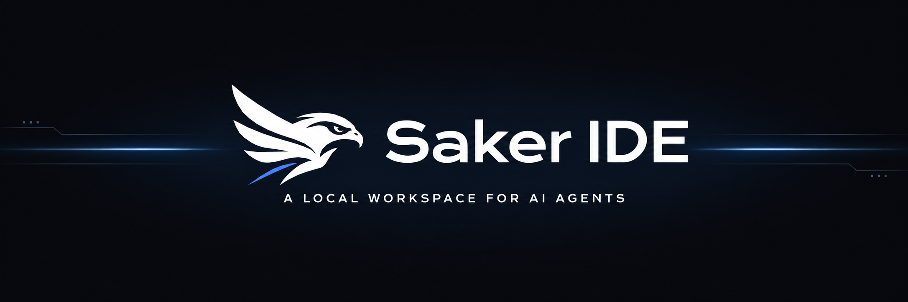

  

# Saker IDE

Saker is a desktop workspace for organizing projects, running AI agents in terminals, and picking up where you left off.

- **Projects and sessions** bring your folders, Git worktrees, and agent terminals into one sidebar.
- **Saker Brain** stores project decisions and next steps in local files. It also shows how files and imports connect. Move project notes between computers with a `.sakerbrain` export. Agents can read and update the notes when project instructions enable it.
- **Accounts and usage** let you switch between supported provider accounts and check usage limits where available.
- **Voice dictation** turns speech into text for the active terminal or text field using your configured model.

## Download for Windows

Open [**Releases → Assets**](https://github.com/FelipeCattoSilva/Saker/releases) and download `saker-windows-setup.exe` for Windows x64. The installer is unsigned. Its SHA-256 checksum is listed in the same release.

## Local data

Saker keeps project notes and workspace data on your computer. Agent providers and integrations may use the network when you use them.

## License

Saker is derived from Orca and distributed under the MIT License. See [LICENSE](LICENSE) for the original copyright and license notice.
